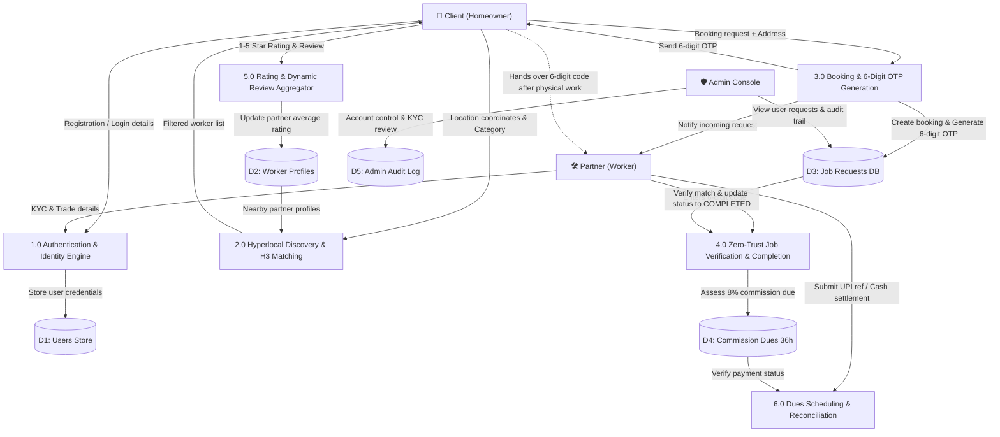
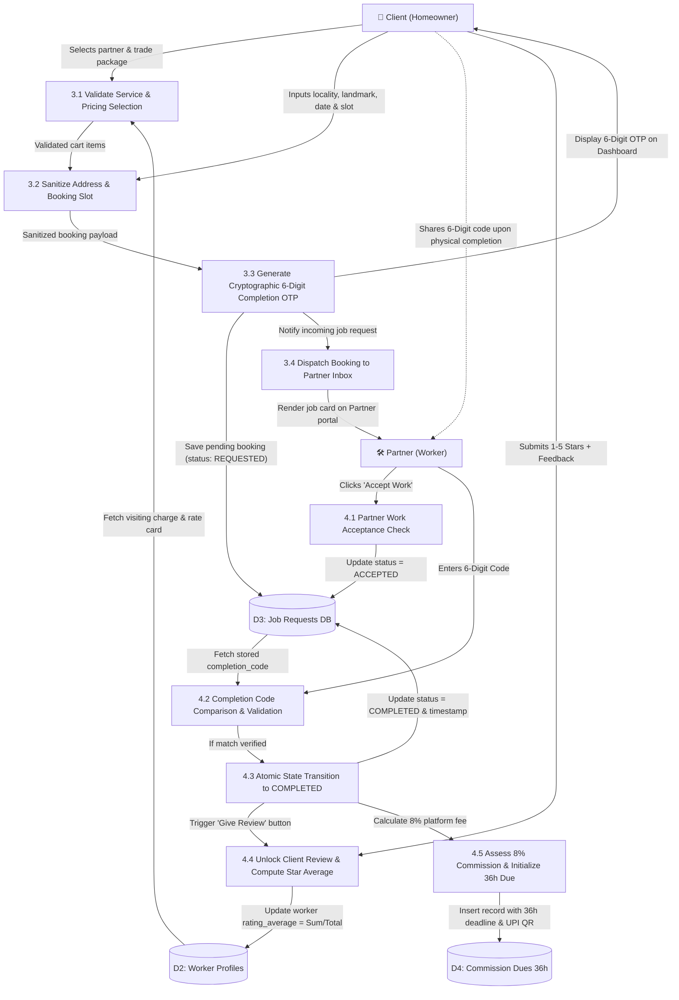

# 🛠️ Connect — Hyperlocal On-Demand Home Services Marketplace

[](https://nodejs.org/)
[](https://react.dev/)
[](https://expressjs.com/)
[](https://www.sqlite.org/)
[](https://www.mongodb.com/atlas)
[](https://h3geo.org/)
[](https://tailwindcss.com/)
[](https://vitejs.dev/)

**Connect** is an enterprise-grade, full-stack hyperlocal marketplace that seamlessly bridges homeowners (clients) with verified local tradespeople and service partners (electricians, plumbers, carpenters, painters). Engineered with a **Decoupled Multi-SPA Architecture**, **Uber H3 Spatial Hexagonal Indexing**, a **Zero-Trust 6-Digit Verification Code Protocol**, a **Dynamic Review Aggregator**, and a **Dual-Database Resilient Engine**, Connect delivers sub-second response times, zero fraud, and transparent 8% commission accounting.

---

## 📑 Table of Contents
1. [System Architecture](#-system-architecture)
2. [Portals & Service Allocation](#-portals--service-allocation)
3. [Key Engineering Innovations](#-key-engineering-innovations)
4. [Technology Stack](#-technology-stack)
5. [Data Flow Diagrams (DFD)](#-data-flow-diagrams-dfd)
   - [DFD Level 1 (System Level)](#dfd-level-1-system-level-decomposition)
   - [DFD Level 2 (Booking & Verification Lifecycle)](#dfd-level-2-booking-otp-verification--review-engine)
6. [Quick Start & Setup Guide](#-quick-start--setup-guide)
   - [Running via VS Code (1-Click)](#a-running-directly-from-vs-code-recommended)
   - [Running via Terminal](#b-running-via-terminal)
7. [Default Demo Credentials](#-default-demo-credentials)
8. [API Endpoints Reference](#-api-endpoints-reference)
9. [Database Schema & Resilience Architecture](#-database-schema--resilience-architecture)
10. [Security & Production Hardening](#-security--production-hardening)
11. [Academic Viva / Examiner Q&A](#-academic-viva--examiner-qa)

---

## 📐 System Architecture

Connect is built upon an isolated **Multi-SPA (Single Page Application) pattern** connecting to a unified **Express.js REST API engine**:

```
                          ┌───────────────────────────┐
                          │   Client App (Port 5174)   │ 
                          │  (Search, Book, Reviews)  │
                          └─────────────┬─────────────┘
                                        │
┌───────────────────────────┐           │           ┌───────────────────────────┐
│   Worker App (Port 5175)  │───────────┼───────────│   Admin App (Port 5176)   │
│ (Accept, OTP Verify, KYC) │           │           │ (Requests, Audit, Review) │
└───────────────────────────┘           │           └───────────────────────────┘
                                        │
                                        ▼
                          ┌───────────────────────────┐
                          │   Node.js / Express API   │
                          │        (Port 5050)        │
                          └─────────────┬─────────────┘
                                        │
                     ┌──────────────────┴──────────────────┐
                     ▼                                     ▼
           ┌──────────────────┐                  ┌──────────────────┐
           │   SQLite 3 DB    │                  │  MongoDB Atlas   │
           │ (ACID & Local)   │                  │ (Cloud Document) │
           └──────────────────┘                  └──────────────────┘
```

---

## 🌐 Portals & Service Allocation

All 4 services run simultaneously using the master process manager (`start-services.js`):

| Portal | Local URL | Port | Primary User & Core Features |
| :--- | :--- | :--- | :--- |
| 🛍️ **Client Portal** | `http://localhost:5174` | `5174` | Homeowners: browse trade categories, live partner cards, instant checkout, address management, secret 6-digit OTP tracking, post-service review modal. |
| 👷 **Partner Portal** | `http://localhost:5175` | `5175` | Service Technicians: live request alerts, Accept/Decline, 6-digit OTP verification keypad, portfolio uploads, service package builder, availability toggle. |
| 🛡️ **Admin Console** | `http://localhost:5176` | `5176` | Operations Team: live platform overview, customer & partner registries with sequential User IDs (`001`, `002`...), requests drawer, immutable audit log. |
| ⚡ **Backend API Server** | `http://localhost:5050` | `5050` | Central REST API: Uber H3 spatial lookups, bcrypt auth, JWT token issuing, CSRF guards, 36h dues monitor, dual-database sync. |

---

## 🚀 Key Engineering Innovations

### 1. Uber H3 Spatial Hexagonal Matching Engine
* Traditional geospatial databases compute pairwise Haversine distance formulas ($O(N)$ database scans) across all technicians.
* Connect converts geographic latitude and longitude coordinates into **Uber H3 Hexagonal Grid Cells (Resolution 7, ~1.2 km diameter)**.
* Partner discovery runs in **$O(1)$ constant time** by querying workers directly mapped to the client's hexagon bucket and immediate concentric rings ($k$-ring query).

### 2. Zero-Trust Job Completion Protocol (6-Digit OTP Handshake)
* **The Problem**: Eliminates fake completion claims where partners claim they completed a job without showing up, or homeowners claim the technician never arrived.
* **The Handshake**:
  1. Upon booking confirmation, the server generates a cryptographically random **6-digit Completion Code** visible strictly to the client.
  2. The partner travels to the site and completes the physical service.
  3. The homeowner hands over the 6-digit code in person.
  4. The partner submits the code through their app $\rightarrow$ the server verifies it $\rightarrow$ status atomically transitions to `COMPLETED`.

### 3. Dynamic Rating & Average Trust Score Aggregator
* As soon as a job is verified as `COMPLETED`, the homeowner portal unlocks the **"Give Review"** button.
* When clients rate a partner (1 to 5 stars + feedback), the backend recalculates a normalized rolling average:
  $$\text{Partner Rating} = \frac{\sum \text{Client Star Ratings}}{\text{Total Completed Jobs}}$$
* This single trusted rating is reflected across search results, partner profile drawers, and worker landing cards.

### 4. Automated 36-Hour Commission Dues Engine
* For cash-on-service jobs, Connect assesses an 8% platform fee.
* A background cron scheduler monitors completed jobs, applies a 36-hour grace window, and generates dynamic UPI payment QR codes (`qrcode.react`) for instant settlement.

### 5. Normalized 3-Digit User Identity (`001`, `002`, `003`...)
* Instead of exposing database primary keys or lengthy UUIDs to clients and partners, users are assigned clean 3-digit identifiers (`001`, `002`, `003`...) formatted across client navbar badges, partner sidebar cards, and admin table columns.

---

## 💻 Technology Stack

### Frontend Architecture
* **Library**: React 18 (`react` v18.3.1, `react-dom` v18.3.1)
* **Bundler & Dev Server**: Vite 6 (`vite` v6.1.0) with ES Modules
* **Styling**: Tailwind CSS v4 (`@tailwindcss/vite` v4.0.0) + Glassmorphism UI tokens
* **Icons**: Lucide React (`lucide-react` v0.475.0)
* **Authentication**: Firebase Authentication (`firebase` v12.17.1) for Google OAuth 2.0
* **Maps & Visuals**: Mapbox GL (`mapbox-gl` v3.29.0) & QRCode SVG (`qrcode.react` v4.2.0)

### Backend Architecture
* **Runtime**: Node.js (v20+ / Native ES Modules)
* **Web Framework**: Express.js (`express` v4.21.2)
* **Security & Auth**: `bcryptjs` (v2.4.3), `jsonwebtoken` (v9.0.2), `crypto`
* **Geospatial**: Uber H3 (`h3-js` v4.5.0), Redis Spatial Driver (`ioredis` v6.0.0)
* **Databases**: SQLite3 (`sqlite3` v5.1.7) & MongoDB Atlas (`mongoose` v9.9.3)
* **Email & Notifications**: Nodemailer (`nodemailer` v9.0.5) & Resend API (`resend` v6.20.0)

---

## 📊 Data Flow Diagrams (DFD)

### DFD Level 1: System-Level Decomposition



---

### DFD Level 2: Booking, OTP Verification & Review Engine



---

## ⚡ Quick Start & Setup Guide

### Prerequisites
* **Node.js** v20.0 or higher
* **npm** v9.0 or higher
* **Git** installed

---

### A. Running Directly from VS Code (Recommended)
1. Open **Visual Studio Code**.
2. Go to **File** $\rightarrow$ **Open Folder...** and select the project directory.
3. If running for the first time on a fresh device without `node_modules`, open the terminal (`` Ctrl + ` ``) and run:
   ```bash
   npm run install:all
   ```
4. **Launch**:
   * Press **`F5`** (or open the **Run & Debug** tab and click the green Play button).
   * *Alternative*: Press **`Cmd + Shift + B`** (Mac) or **`Ctrl + Shift + B`** (Windows) to run the default build task.
5. All 4 services will start concurrently in the integrated terminal!

---

### B. Running via Terminal
```bash
# 1. Clone the repository
git clone https://github.com/surya-4034/Connect.git
cd Connect

# 2. Install all dependencies across all apps in one step
npm run install:all

# 3. Launch all 4 services concurrently
npm start
```

---

## 🔑 Default Demo Credentials

### 1. Homeowner Accounts (Client Portal — `:5174`)
| Account | Email | Password | Formatted User ID |
| :--- | :--- | :--- | :--- |
| **Rohit Verma** | `rohit.test@connect.com` | `Sujal957#` | `001` |
| **Ananya Deshmukh** | `ananya.test@connect.com` | `Sujal957#` | `002` |

### 2. Verified Service Partner Accounts (Partner Portal — `:5175`)
| Partner Name | Trade Title | Email / Phone | Password | User ID |
| :--- | :--- | :--- | :--- | :--- |
| **Surya Yadav (Pro)** | Master Electrician & Plumber Pro | `sy623806@gmail.com` | `Sujal957#` | `001` |
| **Sujal Yadav** | Skilled Trade Specialist | `+91 99999 40340` | `Sujal957#` | `002` |

### 3. Master Administration Console (Admin Portal — `:5176`)
| Role | Admin Email / ID | Admin Password | Access Level |
| :--- | :--- | :--- | :--- |
| **Platform Operator** | `admin@kaam.local` | `ChangeMe-Admin-2026!` | Full Admin Console |
| **Master Admin** | `kaamadmin@gmail.com` | `Sujal957#` | Owner / Governance |

---

## 📡 API Endpoints Reference

### Authentication & Users (`/api/auth`)
* `POST /api/auth/register` — Register a new Homeowner or Partner account.
* `POST /api/auth/login` — Sign in with email/phone & password.
* `POST /api/auth/google-sync` — Synchronize Google OAuth profile.
* `POST /api/auth/update-profile` — Update address, landmark, and contact details.

### Booking Operations (`/api/jobs`)
* `POST /api/jobs` — Create a new service request and generate 6-digit OTP code.
* `GET /api/jobs/worker/:workerId` — Fetch live incoming requests for a partner.
* `GET /api/jobs/client/:clientId` — Fetch booking history and secret OTP codes for a client.
* `PUT /api/jobs/:id/accept` — Partner accepts incoming booking.
* `POST /api/jobs/:id/verify-code` — Partner enters 6-digit code $\rightarrow$ atomic status update to `COMPLETED`.
* `POST /api/jobs/:id/review` — Client submits star rating and review comment.

### Worker Profiles & Discovery (`/api/workers`)
* `GET /api/workers` — Hyperlocal partner search powered by Uber H3 indexing.
* `GET /api/workers/:id` — Retrieve complete partner rate card, packages, and portfolio.
* `PUT /api/workers/availability` — Toggle partner online/offline status.

### Platform Administration (`/api/admin`)
* `POST /api/admin/auth/login` — Admin authentication & CSRF session generation.
* `GET /api/admin/overview` — High-level platform health, revenue, and active jobs.
* `GET /api/admin/resources/:kind` — Paginated resource table for customers, partners, KYC, and dues.
* `GET /api/admin/users/:userId/requests` — View complete request history for a specific customer or partner.

---

## 🗄️ Database Schema & Resilience Architecture

### Hybrid Dual-Database Pattern
Connect utilizes a dual-engine architecture:
1. **Primary Transactional Relational Database (SQLite3)**:
   * File: `server/kaam_database.sqlite`
   * Ensures ACID compliance for bookings, monetary payments, user tables, and 36h dues.
   * Leverages correlated subqueries and `printf('%03d', ...)` for normalized 3-digit User IDs.
2. **Cloud Document Database (MongoDB Atlas)**:
   * Unified cluster: `kaam_db`
   * Stores rich partner portfolio imagery, custom multi-tier service packages, and client preferences.
3. **Automatic Offline Fallback**:
   * If network connectivity to MongoDB Atlas is lost or the current IP is not whitelisted, the backend seamlessly switches to SQLite local execution without crashing or interrupting active users.

---

## 🔒 Security & Production Hardening

* **Explicit SQL Projections**: Queries specifically filter out password hashes, raw OTP completion codes, and government identification numbers from API outputs.
* **Per-Session CSRF Tokens**: Admin mutation requests (`POST`, `PATCH`) validate an `X-CSRF-Token` header generated upon login.
* **Bcrypt Password Salt**: Passwords hashed with 10–12 salt rounds before database persistence.
* **Sanitized Inputs**: Address fields and input parameters sanitized to prevent SQL injection and cross-site scripting (XSS).

---

## 🎓 Academic Viva / Examiner Q&A

**Q1: Why did you separate the frontends into 3 independent applications instead of one?**
> *"In a multi-sided marketplace, client, worker, and admin flows have conflicting design paradigms and security scopes. Decoupling them keeps frontend bundle sizes minimal, prevents role permission leaks, and allows each portal to be deployed independently."*

**Q2: What is the computational advantage of Uber H3 over Haversine distance?**
> *"Computing Haversine distance on every search requires scanning every partner in the database ($O(N)$). Uber H3 pre-indexes the world into discrete hexagonal buckets. Looking up technicians in the client's current hexagon and adjacent rings runs in $O(1)$ constant time."*

**Q3: How does the Zero-Trust 6-digit OTP solve marketplace fraud?**
> *"A common issue in on-demand services is dispute over work completion. By generating a secret code accessible only to the client upon booking, the partner cannot mark the job complete without physically receiving the code at the service site, providing guaranteed physical presence validation."*

**Q4: How does the platform handle rating aggregation?**
> *"Upon OTP verification, the job unlocks a review prompt. The platform computes a running arithmetic average across all completed jobs for that technician, displaying a single trustworthy rating on search cards and public profiles."*

---

## 📄 License & Author
* **Project**: Connect (Local Skilled Trades Marketplace)
* **Author**: Surya Yadav
* **Repository**: [https://github.com/surya-4034/Connect](https://github.com/surya-4034/Connect)
* **License**: MIT
